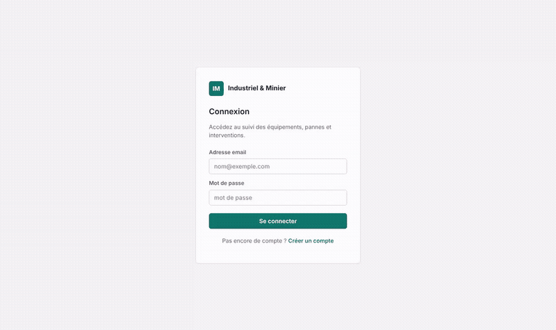
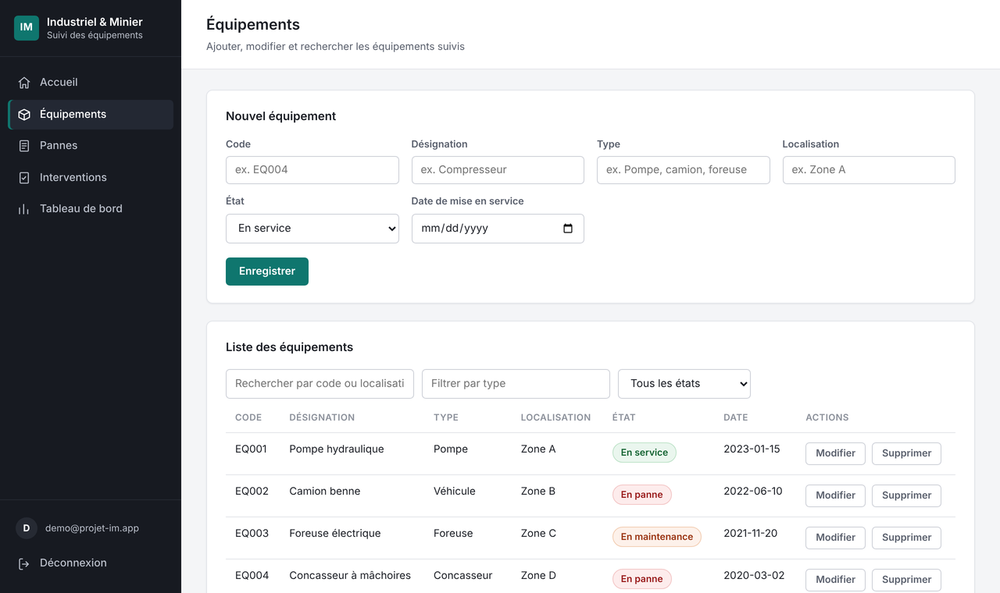
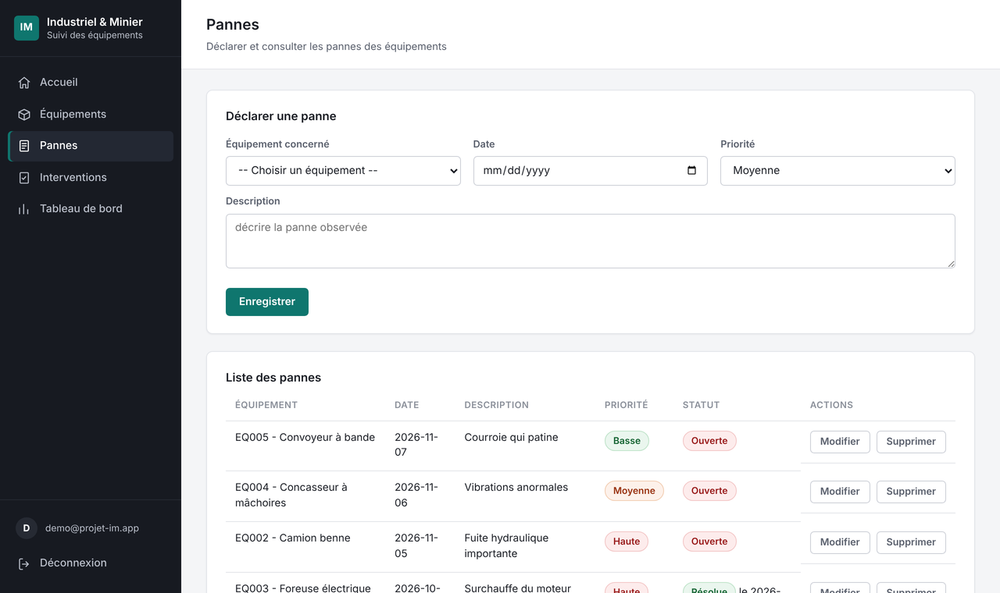
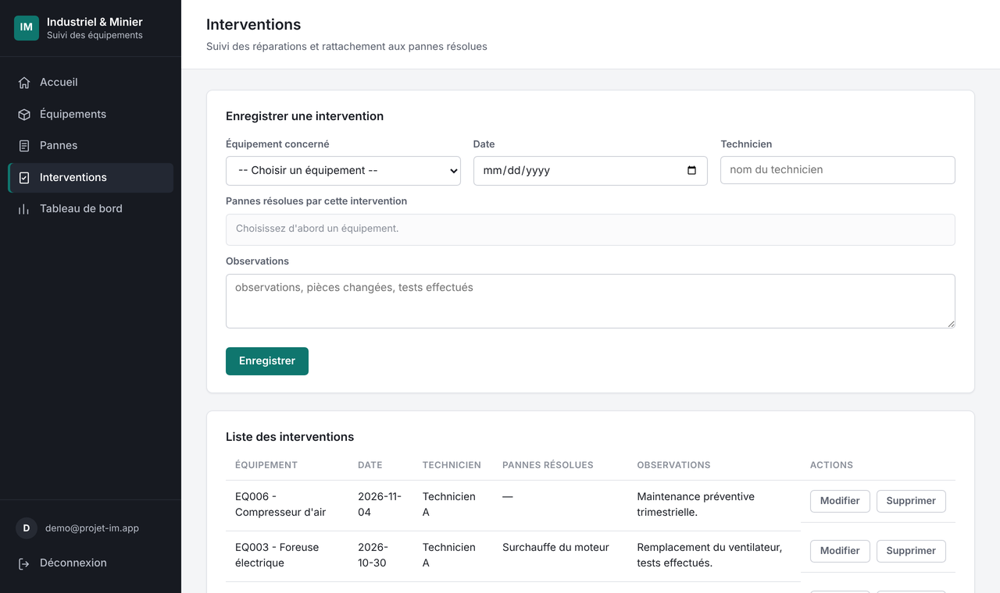
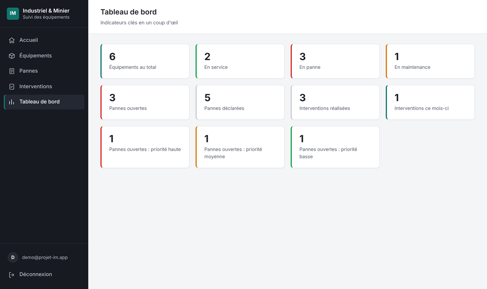
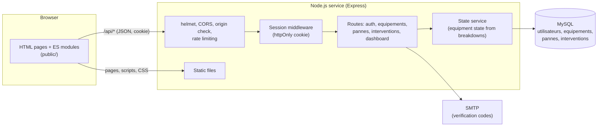
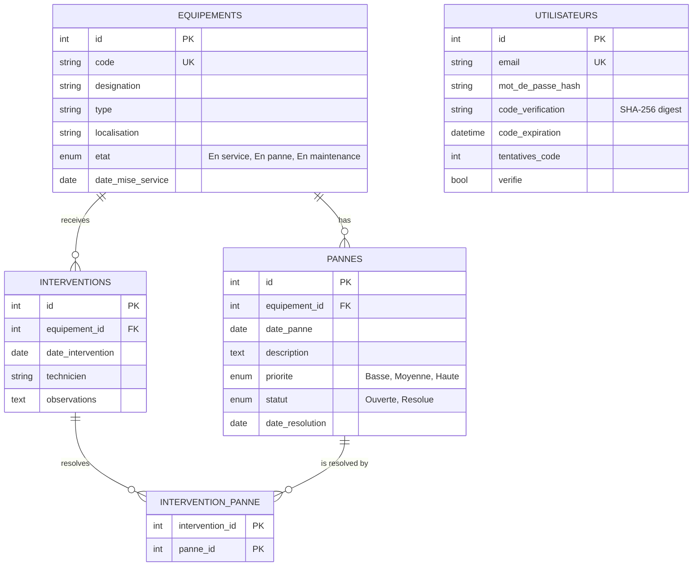

# Industriel & Minier

**A web application to track industrial and mining equipment: breakdowns, repair interventions and a live dashboard, with secure login.**

Individual internship project.

Live demo: TODO (link added after deployment, see [docs/DEPLOY.md](docs/DEPLOY.md)).
Demo account (fictional data, reset regularly): `demo@projet-im.app` / `Demo-2026-IM`.



([Higher-quality video: demo.mp4](docs/screenshots/demo.mp4))

## Context

This is my individual internship project at SNIM (Société Nationale Industrielle et Minière, Mauritania), carried out in September 2026 over four weeks. The assignment was titled "Développement d'une application web de suivi des équipements industriels" (development of a web application to track industrial equipment).

A mine or a factory has many machines; when one breaks down, people need to know which machine, how serious it is, who repaired it and what is still broken. The goal of the internship was an application to follow equipment and its maintenance. The planned features were:

- equipment management (create, read, update, delete);
- equipment states;
- breakdown tracking;
- maintenance interventions;
- search and filters;
- a dashboard.

The stack required by the internship was HTML5, CSS3, JavaScript, SQL and Git. I added an Express backend (Node.js) with a MySQL database.

The interface is in French (the language of the project); the code, the documentation and the commit messages are in English.

**Not an official SNIM product.** This repository contains only fictional demo data; no SNIM data, logos or internal information. Published with the approval of my internship supervisor.

## Project history

1. **The internship version (September 2026).** The first commit ("Initial commit") is the application as I wrote it during the internship.
2. **The November 2026 hardening.** Server-side authentication, security measures, input validation, the breakdown status logic, tests, CI, deployment configuration, the split into ES modules and this documentation were done with AI-assisted development (Claude, by Anthropic), directed and reviewed by me. Each topic is a separate commit, so the two phases can be told apart in the history.

## Features

- **Equipment**: create, edit, delete, search by code or location, filter by type and state.
- **Breakdowns**: declare a breakdown with a priority; each one is `Ouverte` (open) or `Résolue` (resolved) with a resolution date.
- **Interventions**: record who repaired what and select which open breakdowns of that equipment the intervention resolves.
- **Consistent state**: an equipment is `En panne` while it has at least one open breakdown and goes back to `En service` only when none is left. Editing or deleting a breakdown or an intervention recalculates it (`En maintenance` is a manual state and is never overridden).
- **Dashboard**: equipment by state, open breakdowns (total and by priority), interventions this month.
- **Accounts**: sign-up with an e-mailed verification code, login with a session cookie, logout.

## Screenshots

All screenshots use fictional demo data.

|                      Equipment                      |                   Breakdowns                    |
| :-------------------------------------------------: | :---------------------------------------------: |
|  |  |

|                       Interventions                       |                  Dashboard                   |
| :-------------------------------------------------------: | :------------------------------------------: |
|  |  |

## Architecture

One Node.js service serves both the REST API and the static pages, so there is a single thing to deploy and no cross-origin traffic.



### Data model



The schema is in [db/schema.sql](db/schema.sql) and is idempotent; `npm run migrate` applies it and also upgrades a database created by the first version of the project. Example queries are in [docs/queries.sql](docs/queries.sql).

## Security measures

| Risk                         | Measure                                                                                                                                                                                                               |
| ---------------------------- | --------------------------------------------------------------------------------------------------------------------------------------------------------------------------------------------------------------------- |
| Unauthenticated access       | The server checks a signed session cookie on **every** `/api` route except sign-up, verification, login and logout. The browser-side check only improves the user experience.                                         |
| Stolen session script access | The cookie is `httpOnly`, `SameSite=Strict`, and `Secure` in production; sessions expire after 8 hours.                                                                                                               |
| Cross-site request forgery   | `SameSite=Strict` plus a server check that rejects state-changing requests coming from another origin.                                                                                                                |
| Cross-origin calls           | CORS is closed by default; only origins listed in `ALLOWED_ORIGIN` are allowed.                                                                                                                                       |
| Cross-site scripting         | Data is rendered with `textContent` (never `innerHTML`), there are no inline scripts or `onclick` handlers, and a strict Content-Security-Policy (`script-src 'self'`) is sent with `helmet`.                         |
| SQL injection                | Every query is parameterized; search wildcards are escaped.                                                                                                                                                           |
| Bad input                    | All ids, enums, dates and lengths are validated server side; unknown rows answer `404`.                                                                                                                               |
| Password storage             | `bcrypt` hashes; minimum length 8.                                                                                                                                                                                    |
| Verification codes           | Generated with `crypto.randomInt`, stored as a SHA-256 digest, valid 15 minutes, cancelled after 5 wrong attempts, new code at most once a minute.                                                                    |
| Brute force                  | `express-rate-limit` on login, sign-up, verification and resend.                                                                                                                                                      |
| Account enumeration          | Generic messages (and the same response shape) for unknown or existing e-mail addresses on all four routes; a dummy bcrypt comparison hides the difference in response time at login.                                 |
| Secret leakage               | Configuration only from environment variables; `.env` is ignored by git; the verification code is never returned by the API unless `NODE_ENV=development`; production refuses to start without a strong `JWT_SECRET`. |
| Demo abuse                   | In demo mode all data is replaced by fictional data on start and every few hours, and sign-up is disabled without a real SMTP server.                                                                                 |

Known limits: there is one shared data set for all users (no per-user ownership or roles), there is no password reset flow, and sessions cannot be revoked before they expire.

## Run locally

Requirements: Node.js 20 or newer and a MySQL 8 (or MariaDB) server.

```bash
npm install
cp .env.example .env          # then edit DB_* and set JWT_SECRET (see the file)
npm run migrate               # creates / upgrades the tables
npm run dev                   # http://localhost:3000
```

With `NODE_ENV=development` and no SMTP configured, the verification code is printed in the server console so you can test sign-up without a mailbox. To try the demo data locally, set `DEMO_MODE=true`.

## Tests

The API tests (Jest and Supertest) run against a real MySQL-compatible database, not mocks. They cover authentication on every route, cookie flags, verification limits, rate limiting, CORS and CSRF, validation, `404` answers, the breakdown and intervention state logic, the dashboard, the demo reset and the migration of a first-version database.

```bash
mysql -uroot -e "CREATE DATABASE industriel_minier_test"
DB_USER=root DB_PASSWORD= npm test   # 74 tests
npm run lint
npm run format:check
```

GitHub Actions runs lint, the formatting check and the tests against MySQL 8 on every push ([.github/workflows/ci.yml](.github/workflows/ci.yml)).

## Deploy

Free hosting without a credit card: Render (web service) and TiDB Cloud Starter (MySQL-compatible database). Step by step in [docs/DEPLOY.md](docs/DEPLOY.md); [render.yaml](render.yaml) describes the service.

## What I learned

- A value that can be derived should not be stored by hand: the equipment state follows from its breakdowns, so every change to a breakdown or an intervention goes through one function inside the same transaction.
- Security belongs on the server. The first version only checked `localStorage` in the browser, which anyone can edit; the server must be the one that decides who may call the API.
- Testing against a real database found a portability bug (a `GROUP BY` that one server accepted and a stricter one rejected) that mocks would have hidden.
- Small, honest steps: one topic per commit made the history readable and each change testable.

## Development notes

The internship version was written by me (see "Project history" above). The November 2026 hardening (security, restructuring, tests, CI, deployment and documentation) was done with the help of an AI coding assistant (Claude, by Anthropic), directed and reviewed by me; commits made with its help carry a `Co-Authored-By` trailer. All changes are tested before merging.

## License

All rights reserved, see [LICENSE](LICENSE).
